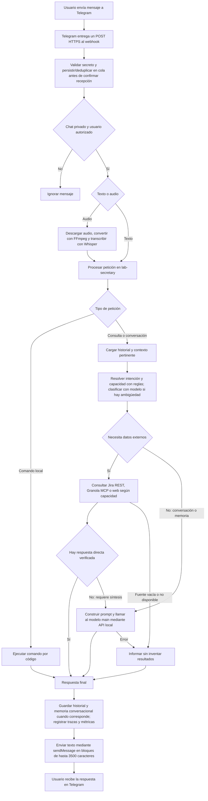

# Donna: recepción y respuesta en Telegram

Verificado el 22 de octubre de 2026 mediante lectura del código y configuración
activa del lab. Alcance: mensaje entrante de texto o voz y respuesta inmediata.
Se omiten tareas programadas y mantenimiento, que tienen ciclos separados.
No se envió ningún mensaje ni se modificó el servicio para esta documentación.

## Cómo leerlo

- **El controlador es Go (`lab-secretary`).** El modelo no recibe cada mensaje
  para decidir libremente qué herramientas ejecutar. El código selecciona las
  capacidades; el modelo puede clasificar peticiones ambiguas y redactar respuestas.
- **Rutas directas:** comandos locales como `/help` y `/status`, aclaraciones y
  resultados deterministas, como tareas Jira por responsables reconocidos.
- **Comandos de consulta:** `/jira` consulta Jira; `/resumen` obtiene tareas y
  reuniones; `/reuniones` obtiene notas y puede llamar al modelo para resumirlas.
  Estos comandos entran directamente en su manejador de fuentes, fuera de la
  clasificación natural representada en el diagrama.
- **Contexto:** historial de conversación, memoria relevante y conocimiento
  aprobado se recuperan según la intención. Con fuentes externas, sus datos
  determinan los hechos actuales; el historial no debe sustituirlos.
- **Modelo:** Telegram usa por defecto `main`. La existencia del destino
  `qwen-eval` no implica reparto automático, consulta a ambos modelos ni consenso.
  La API HTTP permite seleccionar otros destinos; el adaptador Telegram no lo hace.
- **Voz:** audio → FFmpeg → Whisper → mismo flujo de consulta. La configuración
  observada permite transcripción y tiene salida de voz desactivada. La respuesta
  actual se envía como texto. Audio inválido o fallo de transcripción produce aviso.
- **Progreso:** reacciones, indicador de escritura y avisos de etapa pueden
  enviarse mientras se procesa la petición; no son la respuesta final.
- **Persistencia:** no toda rama escribe historial; los comandos administrativos
  tienen su propia semántica. Los turnos normales se guardan antes del envío.
- **Entrega y cortes:** el webhook guarda la actualización antes de confirmar
  recepción; el worker reintenta pendientes tras un reinicio y solo completa el
  registro después de enviar la respuesta. Un corte entre envío y confirmación
  local puede duplicar la respuesta. No hay transporte alternativo.
- **Límites del dibujo:** solicitudes de cambio sin herramienta autorizada se
  bloquean o se limitan a consultar. Tipos de archivo no admitidos reciben aviso.
  Un fallo al enviar a Telegram puede dejar una respuesta guardada pero no entregada.
- **Open WebUI y OpenSearch:** no forman parte obligatoria de este recorrido
  Telegram. Las capacidades Jira/Granola examinadas consultan directamente sus
  servicios; no pasan por OpenSearch.

## Evidencia y límites

Fuentes primarias: `internal/secretary/telegram.go` (`Bot.Run`, `processUpdate`,
`processVoiceWithProgress`, `send`, `Permitted`), `internal/secretary/service.go`
(`reply`, `capabilitiesFor`, `answerFromCapabilities`, `modelFor`, `complete`,
`readCommand`, `remember`) y `cmd/lab-secretary/main.go`.
Configuración objetivo de esta migración: `LAB_SECRETARY_TELEGRAM_MODE=webhook`,
`LAB_SECRETARY_UPSTREAM=http://127.0.0.1:8081`, transcripción activada y voz de
salida desactivada. No se copiaron credenciales.

Fiabilidad alta para el flujo descrito. La configuración se verificó en vivo;
las ramas se trazaron sobre el código del checkout. El ejecutable desplegado tiene
SHA-256 `ee6cb07ab23dd2ce42cbefadc85064d6be8772c4609b3a0304d7b2853af6d1fa`;
no se estableció equivalencia reproducible entre ese binario y todo el checkout.
No se afirma haber probado todas las ramas en Telegram durante esta revisión.

El artefacto de referencia es este documento Mermaid; no se ha validado
visualmente una versión HTML. El borrador anterior se retiró al migrar el transporte.
